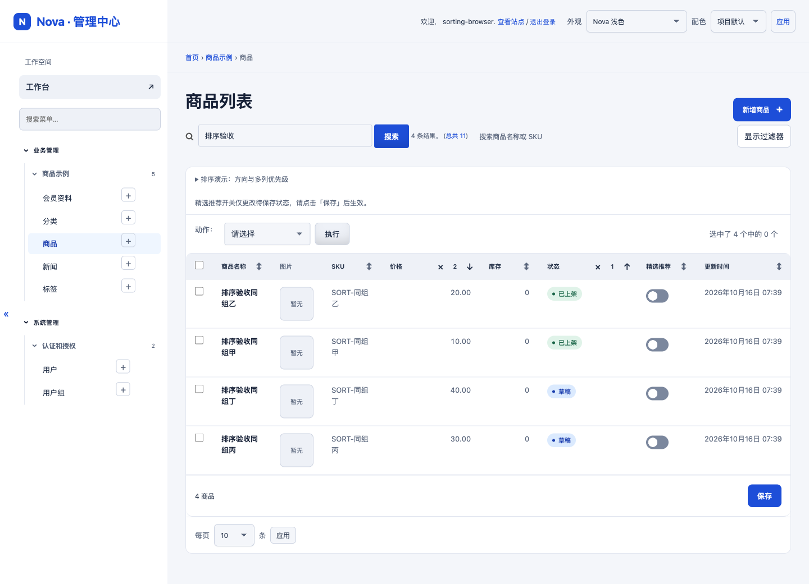
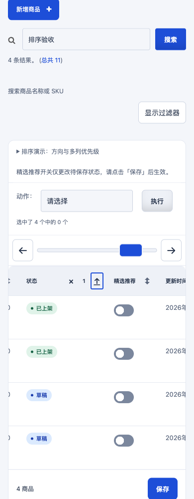

# Django changelist 排序呈现验收 · 2026-10-15

> 历史记录说明（2026-10-24）：以下内容及两张截图来自 2026-10-15 的排序分支验收。当前整合候选仅补入这份历史记录及原截图；运行资源、测试和 CI 配置与已验收的 `main@8091170` 逐字节一致。历史测试和截图不计为本轮重新执行，测试计数勘误见实测表格后说明。

## 基线与交接

- 本地及重新 fetch 后的 `origin/main` 均为 `121a3e0856c1352359347460c1f5076f06f9dca1`。原工作区干净，无 stash、其他 worktree；支持的任务列表未发现另一个本仓库执行任务。系统进程枚举因沙箱限制未执行，未据此声称检查了所有进程。
- 在 `.local/sorting-ui-20261015/source` 的 `codex/changelist-sorting-ui-20261015` 独立 worktree 开发；原 main 工作区及其他项目未改。
- 远端不存在 `feat/changelist-sorting-ui-20261015`；本地交接文件与支持的历史任务记录没有可复用补丁、固定提交或可信测试回执。未读取受限会话存储或 Codex UI，也未把云端 DOM 检查计为本次通过。

## 修改

- 只增强 Django 原生 `#result_list th.sortable`；保留全部 href、查询参数、ModelAdmin / ChangeList、权限和表单逻辑。没有覆盖上游结果模板。
- 未排序列有中性图形，已排序列方向、优先级和移除入口分开布局。列名链接至少 44px 高，次级控件 28×36px，有悬停和键盘焦点提示。不可排序列和选择框列不添加提示。
- 主排序列添加 `aria-sort`；次级状态与优先级通过链接名称表达。已有宿主 ARIA / title 保留，中英文标签与 CSP nonce 转义沿用现有机制。
- 长列名获得更宽文本轨道，在结果区域内横向滚动，不挤占方向和优先级；强制颜色模式保留中性图形。无 JavaScript 时继续使用原生排序链接。
- 商品 Demo 新增可展开的操作说明，使用现有可排序字段、不可排序图片列、自定义 `status_badge(ordering="status")`，不添加模型或迁移。版本仍为 0.6.1。

## 实测结果

| 检查 | 本次结果 |
| --- | --- |
| Python 3.12.14 × Django 5.2.17 / 6.0.8 / 6.1.1 核心测试 | 每组运行 342 项：340 项通过、2 项既有可选集成跳过，含新增 7 项真实 changelist 回归 |
| 真实原生 GET 排序 | 升降序、主列提升、次级切方向、移除首/次/最后列、自定义 ordering、不可排序图片/选择框、宿主 sortable_by 通过 |
| 原生参数及主题恢复 | 中文搜索词、筛选、多值查询、分页容量、facets；light/dark/native/全局关闭；链接逐一与安装的 Django result_headers 输出核对并实际请求通过 |
| Chrome + Django 5.2.17 | 1440/390/320 CSS 像素，light/default 与 dark/forest；截图人工查看，点击填充区域、Enter、真实查询结果、无页面横向溢出、无表头控件碰撞，页面脚本错误与请求失败均为 0 |
| Chrome + Django 6.1.1 | 1440/390，英文及 Demo 紧凑设置；实际 Tab → 移除 → 箭头 → Enter、无 JS 原生排序通过 |
| 服务端真实长表头 | 独立 Django 6.1.1 进程临时设置字段 verbose_name / admin.display description；中文及不含空格英文长词，1440/390/320 全部通过。文本轨道与排序控件不重叠，表头高度 47px，长表头排序链接可点击。不是 DOM 替身测试 |
| 强制颜色 | Chrome forced-colors 下中性图形 CanvasText 可见，截图及计算样式通过 |
| 增强脚本 DOM 测试 | 38 项通过，含 6 项排序回归；不替代以上浏览器检查 |
| 静态预览 | 原有 npm test 全部通过；本次未重写 mock 排序或刷新只读导出 |
| 仓库本地门禁 | Django check、makemigrations --check --dry-run、CSS 预算、配色对比度、既有只读导出完整性、23 项导出安全、65 项 CI 适配器与 25 项矩阵适配器测试、git diff --check 通过 |

计数勘误（2026-10-24）：原表将“342 项运行”写成“342 项通过”。主工作区保留的 `.local/sorting-ui-20261015/django52-tests.log`、`django60-tests.log`、`django61-tests.log` 均明确记录 `Ran 342 tests` 和 `OK (skipped=2)`，因此每组为 340 项通过、2 项跳过，与 [PR #1](https://github.com/mingyueshi/django-nova-admin/pull/1) 的原验证口径一致。原文保留在[排序分支固定提交的验收记录](https://github.com/mingyueshi/django-nova-admin/blob/fe99ecfaa4d7154760560f78a3c650f3bae4b51d/review/changelist-sorting-20261015.md)；本次依据原日志更正历史统计，未重新运行该轮测试。

独立只读代码复核已完成。复核发现“首排序列被 sortable_by 排除时，唯一可排序次级列被误标主排序”的边界，已按原生优先级修复并补 DOM 回归。最终复核未发现剩余阻塞问题。

## 人工复核

1. 按 README 启动真实 Django Demo，打开「商品」列表并展开排序说明。
2. 看商品名称/价格的中性提示；先点价格，再点状态，确认优先级数字、升降方向和实际行序。
3. 点击次级列箭头应保留优先级；点击列名会提升为主列；逐个点击 × 直到全部移除。
4. 搜索并筛选后重复操作，确认参数保留；图片和选择框列没有排序提示。
5. 用 Tab / Enter 检查焦点，在明暗主题、紧凑布局和手机视口横向滚动检查表头。

## 覆盖边界

- 当前本机可用 Python 为 3.12.14；本次本地三组不是仓库既有 3.12.15 精确 CI 矩阵的替代。适用 GitHub CI 以提交后的真实运行回执为准。
- 未重复历史 0.6.1 完整 wheel/可选验证码/Axes/七组 Python 发行验证；这些文件与流程未修改，历史证据不计为此次运行。
- 未覆盖 Firefox/WebKit、实体手机、屏幕阅读器实听、所有第三方 ModelAdmin 覆盖；宿主自定义模板/排序表达式仍需项目验收。负向 `ordering="-field"` 的方向名称跟随 Django 可见箭头契约，不推测底层字段方向。
- 初始本地浏览器 `/favicon.ico` 有既有 404；排序验收开始后没有脚本错误或请求失败。旧只读导出不会展示本次 JS 交互，完整演示需运行 Django。
- 未发布软件包、创建新版本、合并 main，未部署或升级 henhuai.com / csgo114.com。

本地原始日志与浏览器脚本位于 `.local/sorting-ui-20261015/`，截图位于其 `output/playwright/`。临时数据库与登录状态未纳入提交。

人工复核截图（真实 Django 5.2.17 + Chrome 155；桌面折叠筛选器，移动端焦点移到排序箭头）：

## PR CI 汇总契约补充

草稿 PR #1 首次快速 CI（运行 38826435858，head `2dde2c665b7a1deb96139cd444889129b6408a5e`）终态失败。三个精确 Python/Django 组合、构建、可选 Axes 均通过，Node 的安装、前端、导航、38 项增强和验证码测试命令也全部通过；失败发生在 `collect-node` 收集证据阶段：增强测试脚本输出两条总计，而收集器仍严格要求旧的单条 32 项摘要。

修正仅将增强套件输出规范为单条 38 项摘要，并同步收集器及其测试夹具的准确计数（主题 JS 合计 127 项）。缺失、重复、失败、陈旧 32 项摘要及陈旧 121 项报告总数仍会被拒收。新增反向回归后，本地 CI 适配器 66 项通过。运行资源、模板、截图与浏览器代码没有变更，先前真实渲染证据仍适用。新提交的最终 CI 结果以 PR 实际运行回执为准。
